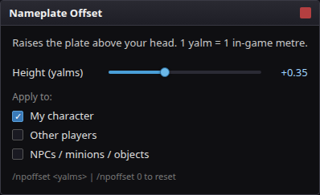
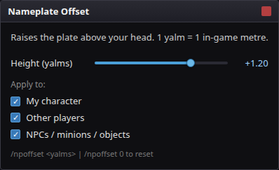
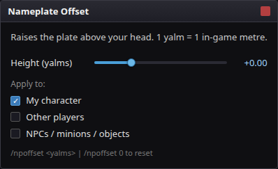
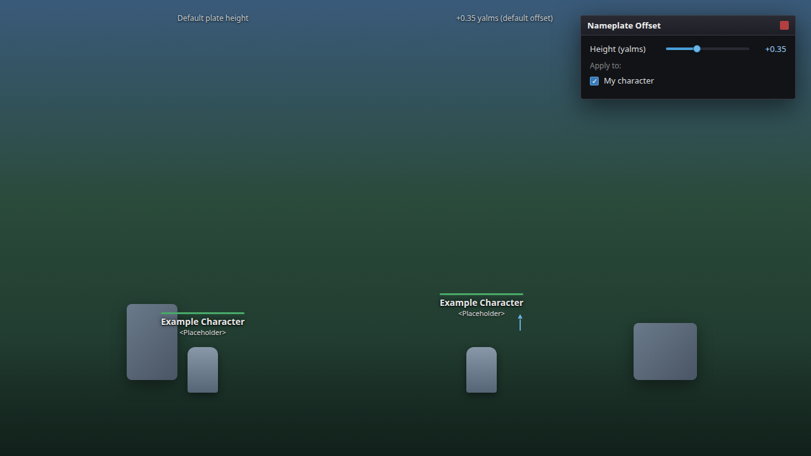
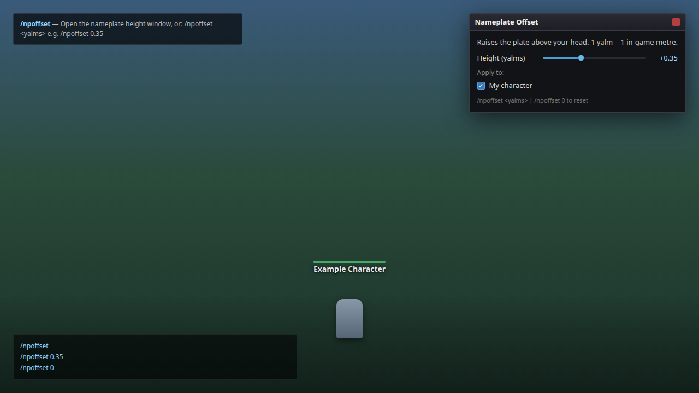

# Nameplate Offset

Raises or lowers the overhead nameplate of a game object in FFXIV, for players who want the plate
clear of a mount, a hat or another plate. Scope is per object type.

`/npoffset` · Dalamud API 15 · .NET 10

## Screenshots

Screenshots are mock-ups illustrating the UI, not captures from the live game.

| | |
| --- | --- |
|  | **Default window** — intro text, **Height (yalms)** at the default +0.35, **Apply to** defaults (My character on), and the in-window command hint. |
|  | **Height slider and Apply to** — raised offset (+1.20 yalms) with all three scope checkboxes enabled. |
|  | **Reset offset** — **Height (yalms)** at +0.00 (same outcome as `/npoffset 0`). |
|  | **Vertical offset effect** — stylised scene showing a nameplate raised by the configured offset (My character scope). |
|  | **`/npoffset` commands** — toggle window, set yalms (`/npoffset 0.35`), and reset (`/npoffset 0`), with the plugin’s registered help text. |

### Feature coverage

| User-facing feature | Shown in |
| --- | --- |
| Configuration window title **Nameplate Offset** | 01–05 |
| Help text: *Raises the plate above your head. 1 yalm = 1 in-game metre.* | 01–03 |
| **Height (yalms)** slider (−1.5 … +3.0, default 0.35, `%+.2f` display) | 01–04 |
| **Apply to:** **My character** (default on) | 01–04 |
| **Apply to:** **Other players** (default off) | 01–02 |
| **Apply to:** **NPCs / minions / objects** (default off) | 01–02 |
| In-window hint: `/npoffset <yalms> \| /npoffset 0 to reset` | 01–03 |
| `/npoffset` — toggle window | 05 |
| `/npoffset <yalms>` — set offset (clamped −1.5 … 3.0) | 05 |
| `/npoffset 0` — reset offset | 03, 05 |
| Open via Dalamud **Open Config** / plugin settings (`OpenConfigUi`) | 01 (same window) |
| Nameplate moves up/down in world (visual result) | 04 |

Mock-up sources live under `docs/screenshots/src/`; regenerate PNGs with `node docs/screenshots/src/render.mjs` (requires `npm install playwright` in that folder once).

## What it does

- **Offsets the plate vertically** — in yalms (1 yalm = 1 m), slider −1.5 to +3.0, default 0.35.
- **Scopes independently** — my character, other players, NPCs/minions/objects.
- **Restores on exit** — every config change and `Dispose()` puts the captured baselines back.

## How it works

FFXIV has no vanilla control for nameplate height. The plate is anchored in world space at the
object's `GetNamePlateWorldPosition()` — bottom-centre of the plate — computed from:

```
character position + NameplateOffset (rotated by actor rotation) + (0, NameplateOffsetScaleMultiplier * Scale, 0)
```

`NameplateOffset` lerps each frame toward `NameplateOffsetTarget`. Writing `NameplateOffsetTarget.Y`
(and `NameplateOffset.Y` to skip the lerp) is what the client itself does for mount/transform
offsets; `MidoriKami/VanillaPlus` uses the same field for its `DutyPortalNameplateOffset`.

Per-object baselines: the game rewrites `NameplateOffsetTarget` on spawn, mount and transform — if it
no longer holds what we wrote, that is the game talking, so it is adopted as the new baseline instead
of fought. Restore goes through `IObjectTable.CreateObjectReference`, so a freed object pointer is
never dereferenced.

## Commands

| Command | Effect |
| --- | --- |
| `/npoffset` | toggles the window |
| `/npoffset 0.35` | sets the offset in yalms, clamped to −1.5 to 3.0 |
| `/npoffset 0` | resets |

## Settings

- **Height (yalms)** — the offset, slider −1.5 to +3.0, default 0.35.
- **Apply to** — my character (on), other players (off), NPCs/minions/objects (off).

## Build

Requires the .NET 10 SDK and the Dalamud dev distribution
(`%APPDATA%\XIVLauncher\addon\Hooks\dev`, or `DALAMUD_HOME`).

```
dotnet build -c Debug      # load bin/Debug/NameplateOffset.dll as a dev plugin
dotnet build -c Release    # zip in bin/Release/NameplateOffset/latest.zip
```

`Dalamud.NET.Sdk/15.0.0` supplies the references and renders the manifest from the csproj
properties — never add a hand-written `NameplateOffset.json` to the project; the packager merges one
over the props.

## Install (dev plugin)

1. `%APPDATA%\XIVLauncher\devPlugins\NameplateOffset\` must contain `NameplateOffset.dll` **and**
   `NameplateOffset.json` — manifests are required since Dalamud dropped the DLL-only scan, and a DLL
   with no matching-stem JSON is logged as "no longer valid" and ignored.
2. `/xlplugins` → Dev Tools (opening the installer runs `ScanDevPluginsAsync`; there is also a "Scan
   Dev Plugins" button) → enable **Nameplate Offset**. Nothing is auto-loaded.
3. `/npoffset` opens the window.

`InternalName` in the manifest must equal the DLL filename stem.

## Limits

- No plugin-repo (DIP17) entry — `RepoUrl` is empty — so it loads only as a dev plugin built from
  source, with no published release zip.
- The anchor formula is read off the client's own behaviour and VanillaPlus; the result on every
  mount and transform is not verified in game.

## Layout

```
Plugin.cs               offset loop, command, window, Configuration
NameplateOffset.csproj  manifest properties, Dalamud SDK
```
